= *USBSID-Configtool manual*
:author: LouD
:description: This document contains information about the USBSID-Configtool and how to use it
:url-repo: https://www.github.com/LouDnl/USBSID-Configtool
:revdate: {localdate}
:hide-uri-scheme:
:toc:
:toclevels: 4
:toc-placement!:

Author: {author} - generated on {revdate}

toc::[]
[%always]
<<<

== Disclaimer
include::disclaimer.adoc[]

== About
What is there to say, you can configure your board with this tool and it is self explanatory. +
Prefer the command line? A CLI config tool (`cfg_usbsid`) is also available ~ see the `USBSID-Pico-firmware-manual` file for its usage.

== Drivers
include::drivers.adoc[]

== Screens

=== Welcome screen
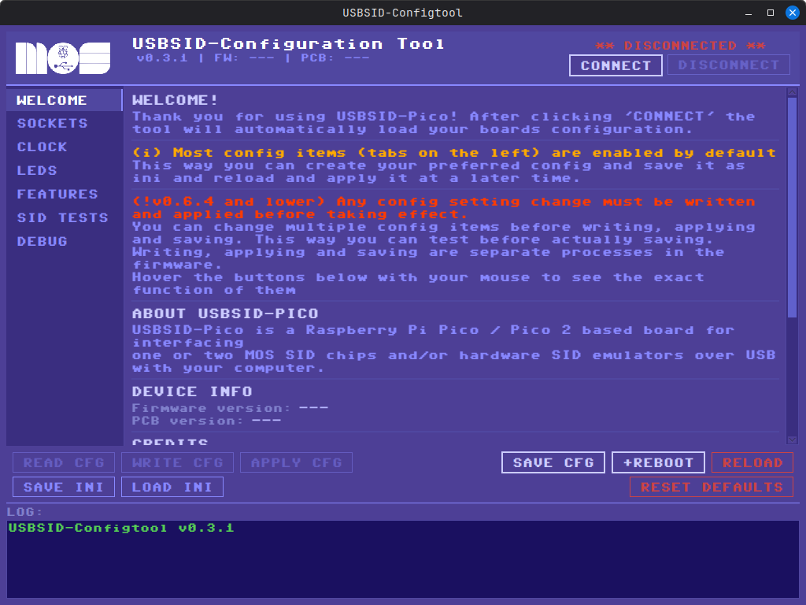 +
 +
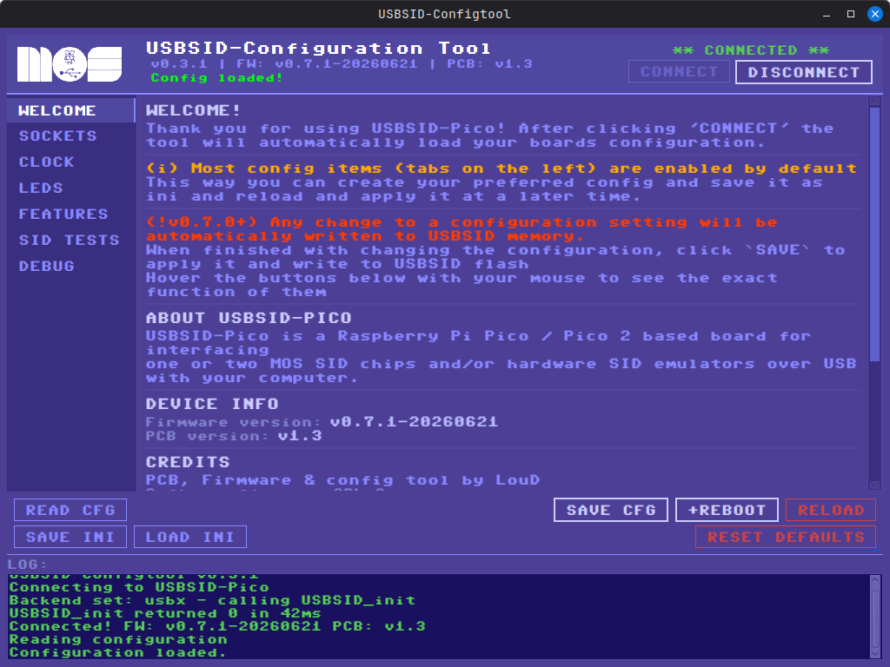 +

=== v1.5 Sockets confirmation message
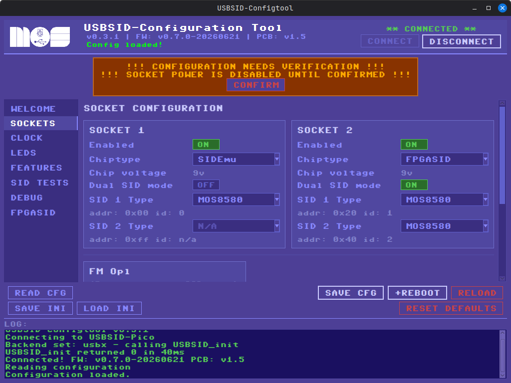 +

=== Sockets screen
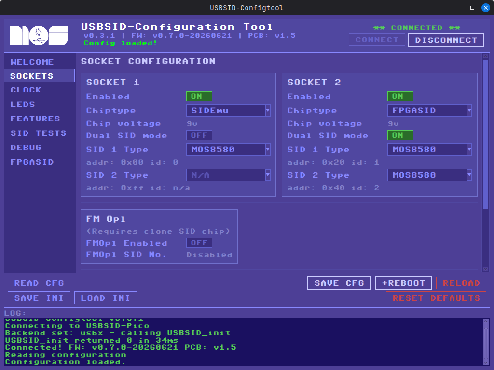 +
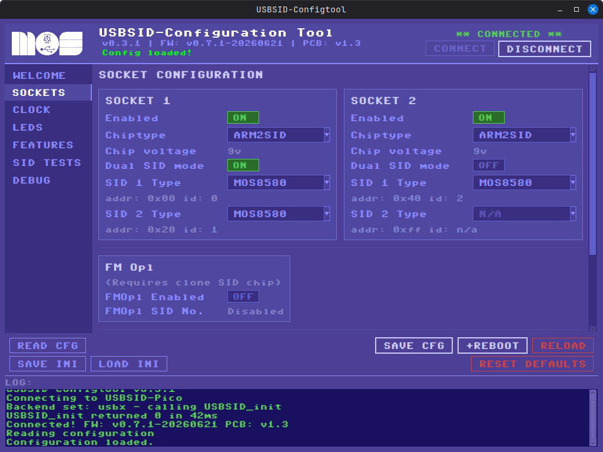 +

=== Clock screen
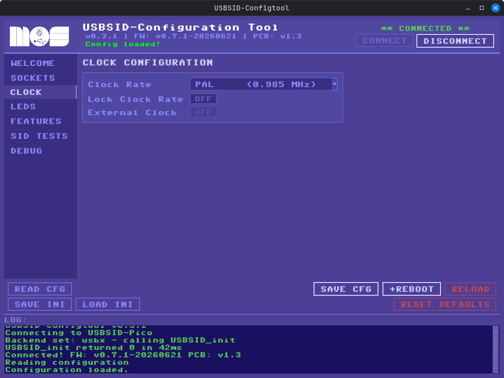 +

*External Clock*: display only. The firmware detects an external clock source at startup and reports it in the configuration, it cannot be set from the Configtool.

*Clock link*: enables or disables the board clock link (LINK_CLOCK command 0x84, state read from configuration byte 6 bit 1). The firmware saves the configuration and reboots the board when the value changes. The Configtool disconnects and the board must be reconnected afterwards.

=== LEDS screen
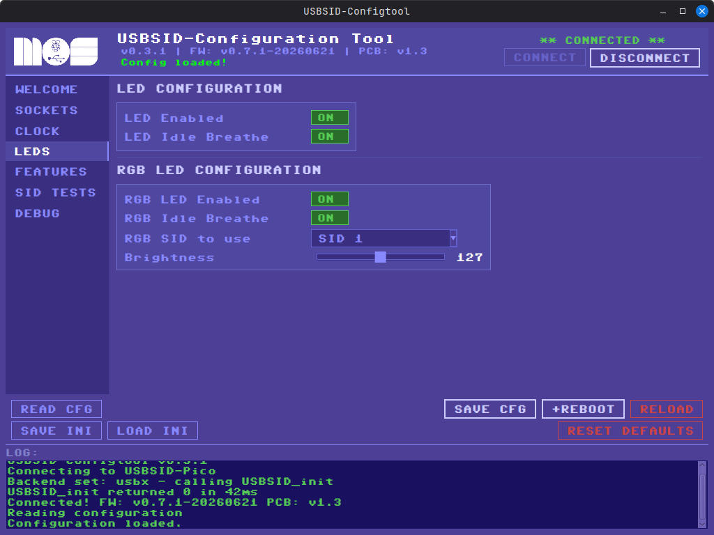 +

=== Features screen
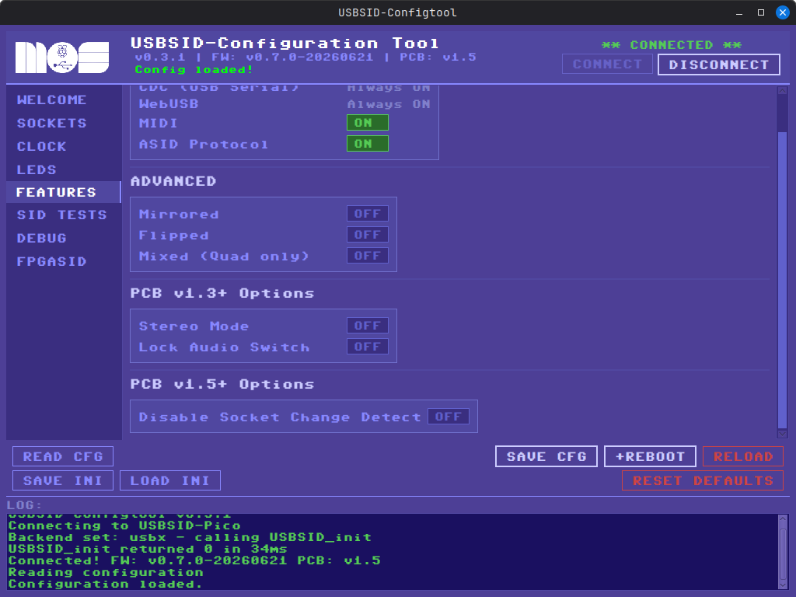 +
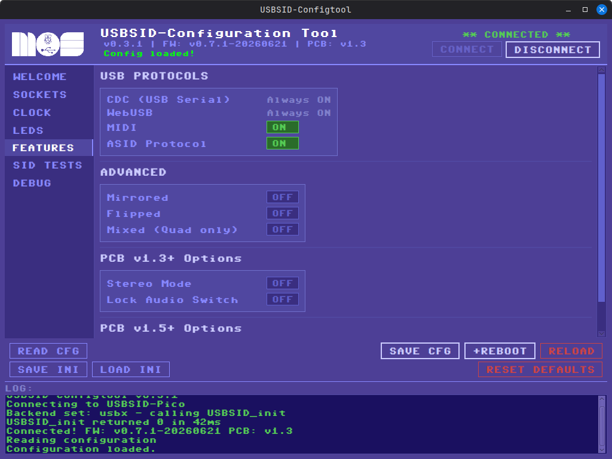 +

*USB RX ringbuffer*: buffers up to 8 incoming USB packets and prevents cracks on write-heavy tunes. Default on. Listed under ADVANCED next to Preset auto detect, written with the other settings (SET_CONFIG item 17) and stored in the ini file as `rx_ring` in the `[Features]` section. The setting applies after saving the configuration and rebooting the board. Available on firmware newer than v0.8.1.

*Preset auto detect*: toggle under ADVANCED, written as SET_CONFIG item 16 (BOARD_PADETECT).

*FMOpl SID No.*: selector in the FM Opl block on the Sockets screen, enabled when FMOpl is on. The selected SID number (1 to 4) is sent with SET_CONFIG item 9 (BOARD_FMOPL) and must be a SID that has an address assigned. Selecting Unknown (0) while FMOpl is enabled clears the assignment.

=== SID tests screen
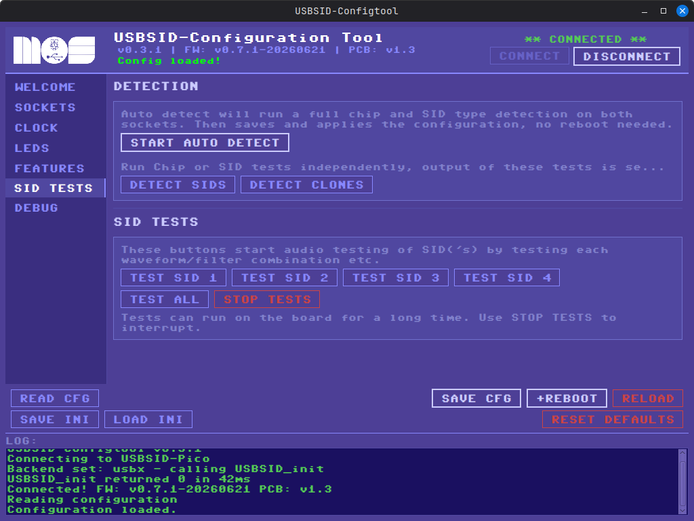 +

=== Debug screen
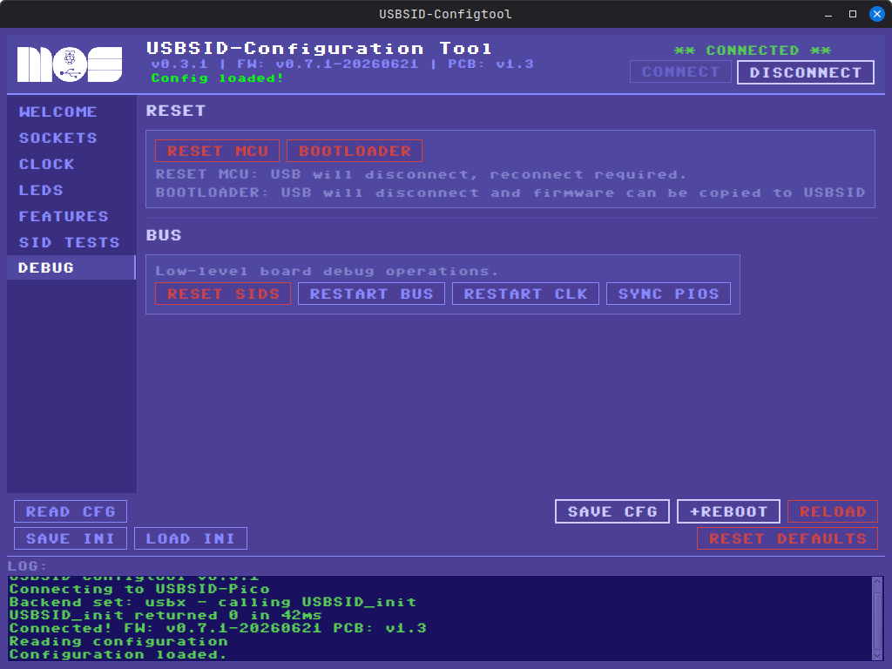 +

The `RESET SID REGISTERS` button resets all SID registers (same as `cfg_usbsid --reset-sid-registers`).

== Development
More information about USBSID-Configtool is available on the https://github.com/LouDnl/USBSID-Configtool[github repo]

== License
include::license-software.adoc[]

include::license-hardware.adoc[]

Author: {author} - generated on {revdate}
